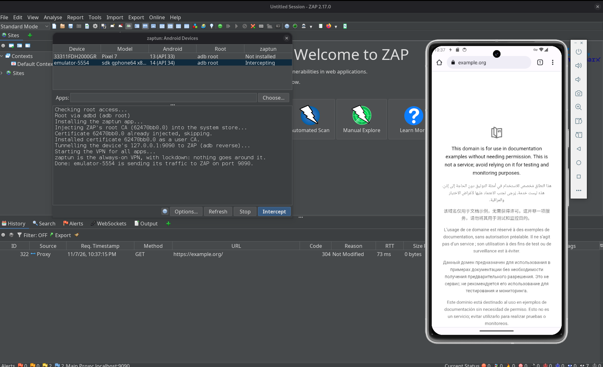
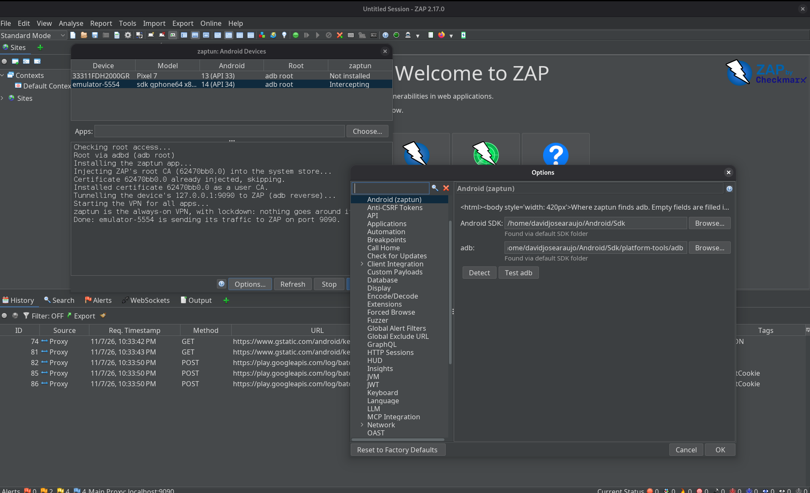
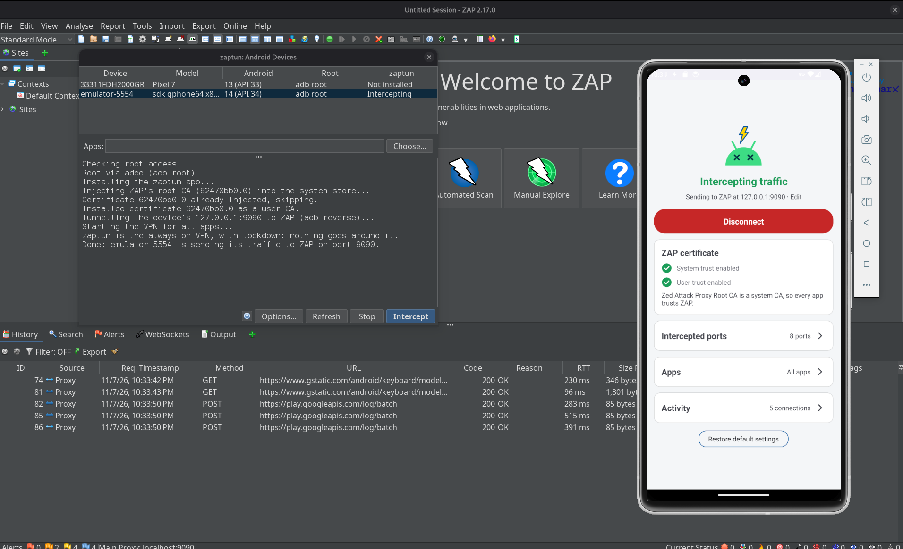

<p align="center">
  
</p>

# zaptun

**Capture all traffic of an Android emulator or rooted device in
[OWASP ZAP](https://www.zaproxy.org/), with one click.**

zaptun is a ZAP add-on. Pick a device in *Tools → Android Devices...* and click
**Intercept**. The add-on then:

1. installs the zaptun VPN app on the device over adb;
2. injects ZAP's root CA into the device's **system** CA store, including the
   Conscrypt APEX on Android 14+, and also installs it as a **user** CA (the
   system change lives in RAM and only reaches processes whose mount namespace
   got it, while the user CA is a file in `/data` that every process sees);
3. forwards the device's `127.0.0.1:<port>` to ZAP with `adb reverse`;
4. starts the VPN. Every TCP connection on the device then goes through ZAP,
   including apps that ignore the system proxy (Flutter, OkHttp with
   `Proxy.NO_PROXY`, raw sockets, ...);
5. makes zaptun Android's **always-on VPN with lockdown** ("Block connections
   without VPN"), so no app traffic gets around ZAP even while zaptun reconnects,
   restarts or hasn't started yet after a boot. See [Lockdown](#lockdown).

There's nothing to export, push or configure by hand.



You can also do it without the add-on, from a shell: `scripts/zaptun.sh start`
does the same steps (see [Without the add-on](#without-the-add-on-scriptszaptunsh)).

## Repository layout

| Path | What it is |
|---|---|
| [`zap-addon/`](zap-addon/) | **The ZAP add-on** (Java). The device table, the intercept/stop logic, the ZAP API and the help pages shown in ZAP. It follows ZAP's [add-on template](https://github.com/zaproxy/addon-java). |
| [`android-app/`](android-app/) | The VPN app (Kotlin) that the add-on installs on devices. It's built and bundled into the add-on automatically. |
| [`scripts/`](scripts/) | `zaptun.sh`, for using the app without the add-on, and the CA injection scripts that the add-on and `zaptun.sh` both push to the device. |

## Requirements

- **ZAP 2.16+**.
- **adb**, from the Android SDK platform-tools. No environment variables are
  required: see [Configure adb](#configure-adb).
- **Root on the device**, because injecting a system CA needs it. Two options:
  - an emulator with a **"Google APIs"** image. "Google Play" images can't
    `adb root`. The add-on runs `adb root` for you;
  - a rooted phone with `su` (e.g. Magisk). Grant root to "Shell" when asked.
- ZAP's proxy bound to `localhost` or all interfaces, which is the default.
  `adb reverse` connects to localhost.

## Install

Build the add-on (see [Build](#build)), then in ZAP open *File → Load Add-on
File...* and pick `zap-addon/build/zapAddOn/bin/zaptun-alpha-<version>.zap`.

The add-on's help, in ZAP's *Help* menu or with the **?** button in the devices dialog,
covers its UI, options and API.

## Configure adb

Open *Tools → Options → Android (zaptun)*, or click **Options...** in the
devices dialog. The page has two fields:



- **Android SDK**: the SDK folder. adb is taken from its `platform-tools`.
- **adb**: the adb binary itself. If set, it takes priority over the SDK.

When a field is empty, the page fills it in and says where the value came from:
`ANDROID_HOME`, then `ANDROID_SDK_ROOT`, then Android Studio's default SDK
folders (`~/Android/Sdk`, `~/Library/Android/sdk`,
`%LOCALAPPDATA%\Android\Sdk`), then `PATH`. **Detect** fills both fields in
again from the environment, and **Test adb** runs `adb version` with what's in
the fields. If you save the page with both fields empty, zaptun keeps detecting
adb from the environment every time.

## Use

### From ZAP's UI

Open *Tools → Android Devices...*, or click the phone button in the toolbar.

- The table lists every adb device with its Android version, its root method
  and whether it's being intercepted.
- **Apps** is optional. Leave it empty to capture everything, or click
  **Choose...** to pick packages from the device.
- **Intercept** runs the steps above and logs each one. **Stop** turns lockdown
  off, then the VPN, and removes the `adb reverse` rule.



The system CA injection lives in RAM, so it's lost when the device reboots. Click
**Intercept** again after a reboot. It's safe to click it again at any time.
Start or restart the app you want to capture after clicking **Intercept**: an
app that's already running keeps the CA store it started with.

### From the ZAP API (scripts, CI)

```shell
# Device list (serial, model, android, sdk, root, installed, intercepting)
curl "http://localhost:9090/JSON/zaptun/view/devices/?apikey=$KEY"

# Intercept the only connected device, or pick one with serial=; apps= is optional
curl "http://localhost:9090/JSON/zaptun/action/intercept/?apikey=$KEY&serial=emulator-5554&apps=com.example.app"

curl "http://localhost:9090/JSON/zaptun/action/stop/?apikey=$KEY&serial=emulator-5554"
```

Progress and the reasons for failures are written to ZAP's log (`zap.log`).

The adb settings are on the API too, for ZAP running headless:

```shell
curl "http://localhost:9090/JSON/zaptun/view/adb/?apikey=$KEY"   # the adb zaptun will run
curl "http://localhost:9090/JSON/zaptun/action/setOptionSdkPath/?apikey=$KEY&String=/opt/android-sdk"
curl "http://localhost:9090/JSON/zaptun/action/setOptionAdbPath/?apikey=$KEY&String=/usr/bin/adb"
curl "http://localhost:9090/JSON/zaptun/action/useDetectedAdb/?apikey=$KEY"   # clear both, detect again
```

You can also set them when starting ZAP:
`zap.sh -daemon -config zaptun.sdkPath=/opt/android-sdk`.

### Without the add-on: `scripts/zaptun.sh`

With ZAP running, and the app built (`./gradlew -p android-app :app:assembleDebug`):

```shell
export ANDROID_SERIAL=emulator-5554             # optional, picks the device
scripts/zaptun.sh install                       # once: install and pre-approve the VPN
scripts/zaptun.sh start                         # CA + VPN, ZAP on port 9090, all apps
scripts/zaptun.sh start 9090 com.example.app,com.example.other
scripts/zaptun.sh stop
```

It runs on Linux and macOS: it needs bash (3.2, macOS's own, is enough), curl and
openssl. On Windows, use the add-on. The port defaults to 9090, but a fresh ZAP
listens on 8080, so pass ZAP's port if yours differs: `scripts/zaptun.sh start 8080`.
adb is found the way the add-on finds it: `ANDROID_HOME`, `ANDROID_SDK_ROOT`,
Android Studio's SDK folders (`~/Library/Android/sdk`, `~/Android/Sdk`), then
`PATH`.

`install` runs `appops set ... ACTIVATE_VPN allow`, so the VPN starts without the
consent dialog. `start` does what **Intercept** does:

1. Downloads ZAP's root CA from ZAP. It uses the one-time link on ZAP's
   `http://zap/` welcome page, so no API key and no manual export are needed.
   Set `ZAP_CERT=file.pem` to use a file instead.
2. Runs `adb root`, then injects the CA into the system store with
   `scripts/inject_ca.sh` and installs it as a user CA with
   `scripts/install_user_ca.sh`. Running `start` again is safe: the CA is skipped
   if it's already injected.
3. Runs `adb reverse tcp:<port> tcp:<port>`, so the device's `127.0.0.1:<port>` is
   this machine's, where ZAP listens. The emulator's `10.0.2.2` alias works too,
   but its network adds about a second to every new connection, while the adb
   tunnel adds a few milliseconds. To use another address without `adb reverse`
   (a phone reaching ZAP over Wi-Fi, say), set `ZAP_DEVICE_HOST`, e.g.
   `ZAP_DEVICE_HOST=10.0.2.2 scripts/zaptun.sh start`. `stop` removes the rule.
4. Starts the VPN pointing at `127.0.0.1:<port>`, with the CA's fingerprint for the
   app's trust check. Listing apps switches the app to "only these apps"; leaving
   them out captures all apps.
5. Once the VPN is up, turns on [lockdown](#lockdown); `stop` turns it off first.
   Set `ZAPTUN_ALWAYS_ON=0` to leave Android's always-on VPN setting alone.

The script needs a root adb shell, so a "Google APIs" emulator image. For a phone
rooted with `su`, use the add-on. As with **Intercept**, run `start` again after a
reboot (the CA injection and the `adb reverse` rule don't survive it), and start
or restart the app you want to capture afterwards.

### Check it works

- ZAP's History shows hostnames, not IPs, for HTTPS traffic from apps.
- The app's **System trust enabled** row has a green tick.
- `adb logcat -s zaptun` shows lines like `TLS api.example.com:443 → ZAP`.
- A connection that fails with `proxy said: HTTP/1.1 502 ...` means ZAP couldn't
  reach the destination; `Connection refused` means ZAP isn't listening on that
  port.

### On the device

The zaptun app shows a single page:

- the connection status, with a **Disconnect**/**Connect** button and the ZAP
  address it sends to (tap the address to edit it);
- whether ZAP's CA has **system trust** and **user trust** on this device. The
  add-on passes the CA's fingerprint, so the app checks for ZAP's current CA;
- the **intercepted ports**: tap one to remove it, or type one or more into
  the field and tap **+ Add**. **Restore defaults** brings back the default
  ports (80, 443, 8000, 8008, 8080, 8443, 8888, 9000). **Also find HTTP on every
  other port** looks at the other ports too (see
  [How the VPN works](#how-the-vpn-works)). Changes apply right away, without
  reconnecting;
- the **apps**: either all apps except the ones you switch off, or only the
  ones you switch on. Each change reconnects the VPN, with no gap (see below);
- **Activity**: the recent connections, newest first, each with where it went
  (`→ ZAP` or `→ direct`), the bytes moved each way, how long it lasted and who
  closed it, or why it failed. It includes connections that aren't intercepted
  and non-HTTP protocols, so you can see what an app is doing beyond ZAP's
  reach. Under it are counters for what zaptun refused or passed through:
  UDP, IPv6 and DNS. **Clear** empties it. The same lines go to logcat:
  `adb logcat -s zaptun`.

**Restore default settings**, at the bottom of the page, asks first and then resets
the ZAP address, the ports and the app selection (all apps). If zaptun is
connected it reconnects, so after this the add-on's `127.0.0.1` address is gone:
click **Intercept** in ZAP again to set it up.

While connected, zaptun shows an ongoing notification with a **Disconnect** button,
which also keeps Android from stopping it in the background. If Android does kill
the app while it's connected, the VPN comes back by itself; if you disconnected,
it stays off. It follows the device from one network to another (Wi-Fi to
mobile) and can be set as an always-on VPN in Android's settings.

The ports, apps and activity sections are collapsible and start collapsed, with a summary
in their header (e.g. "8 ports", "All except 1"). The app list refreshes when you
come back to zaptun and when an app is installed or removed while it's open, so an
app you install after starting zaptun shows up without restarting it.

Picking apps in ZAP's dialog switches the app to "only these apps". Leaving the
apps empty there switches it back to "all apps".

### Lockdown

Android can keep one VPN always on and, with lockdown ("Block connections without
VPN" in its settings), give apps no network at all when that VPN is down. Without
it, any moment zaptun isn't running (a crash, a restart, the time after a boot
before it starts) lets apps talk to the internet directly, and ZAP misses that
traffic.

**Intercept** and `zaptun.sh start` turn this on once the VPN is up; **Stop** and
`zaptun.sh stop` turn it off before stopping the VPN. Only system code may change
the setting (the permission can't be granted with `pm grant`), so they run a small
tool from zaptun's own APK as root, the way scrcpy runs its server:

```shell
adb shell 'CLASSPATH=$(pm path dev.davidjosearaujo.zaptun | cut -d: -f2) \
    app_process /system/bin dev.davidjosearaujo.zaptun.AlwaysOnVpn status'   # or on, off
```

- In "all apps except..." mode the excluded apps are allowed around the lockdown
  (Android 10+). An app you exclude later in the app only gets its network back
  at the next **Intercept** or `start`. Before Android 10 there is no such list,
  so with excluded apps zaptun is always-on without lockdown.
- In "only these apps" mode the other apps aren't on the VPN, and lockdown would
  cut them off, so zaptun is always-on without lockdown.
- While lockdown is on, **Disconnect** in the app leaves apps with no network.
  Use **Stop** in ZAP or `zaptun.sh stop` to end a session.
- It covers apps, not root: processes running as root (e.g. `adb shell` after
  `adb root`) still go around a stopped VPN.
- If the device reboots with lockdown on, Android starts zaptun by itself, but the
  CA and the `adb reverse` rule are gone, so nothing gets through until you click
  **Intercept** (or run `start`) again.

### Android's global proxy

If the device has a global proxy (`settings put global http_proxy host:port`, which
older setups and launch scripts use), apps that honour it send their traffic
straight to that proxy and never meet the VPN. So while zaptun is connected it
switches the global proxy off, and when you disconnect it puts the old value
back. It logs this (`adb logcat -s zaptun`). If someone sets a different proxy in the
meantime, zaptun leaves that one alone, and if the app is killed while connected,
it restores the proxy the next time it opens.

Changing a global setting needs a permission that the add-on grants over adb when
you click **Intercept**, and `zaptun.sh` on `install` and `start`
(`pm grant ... WRITE_SECURE_SETTINGS`). Without it, on a
Magisk-rooted phone zaptun tries `su` instead. On a stock emulator image apps
can't use `su`, so there the permission is the way, and without it zaptun logs
the command to run.

A proxy set by the **emulator itself** (the `-http-proxy` launch flag) is outside
the device, so zaptun can't switch it off. With it, even the connections zaptun
sends "direct" go through that proxy.

## How the VPN works

```
app ──► tun ──► TcpNat (header rewrite) ──► local relay ──► CONNECT host:port ──► ZAP
```

- The VPN routes all IPv4 traffic into a tun interface. `TcpNat` rewrites each
  TCP packet's headers so the connection lands on a local relay socket, and the
  kernel's own TCP stack does the real TCP work.
- Only connections to the **intercepted ports** reach ZAP. The defaults are
  80, 443, 8000, 8008, 8080, 8443, 8888 and 9000, and you can edit them in
  the app. Connections to any other port go straight to their destination,
  unless **Also find HTTP on every other port** is on: then the relay waits
  half a second for the app's first bytes on every other port too, and sends
  plain HTTP, and TLS whose ClientHello offers HTTP with ALPN (`h2`,
  `http/1.1`), to ZAP. Other TLS (MQTT, IMAP, XMPP over TLS...) still goes
  direct, since ZAP would break it, and a protocol where the server speaks first
  (SSH, SMTP) goes direct after that half second.
- For an intercepted port, the relay reads the start of the connection:
  - **TLS**: it takes the hostname from the ClientHello (SNI) and opens
    `CONNECT <sni>:<port>` on ZAP, so ZAP's certificates and History use real
    hostnames.
  - **Plain HTTP**: it takes the hostname from the `Host` header and also uses
    `CONNECT`.
  - **Requests already sent to a proxy** (apps using the global `http_proxy`)
    are handed to ZAP unchanged.
  - **Anything else** (e.g. a non-HTTP protocol on port 8000) goes straight
    to its destination, so those apps keep working.
- DNS is forwarded to the device network's own resolvers, over UDP and over TCP
  (an answer too big for one packet is cut short so the resolver retries over
  TCP). Other TCP aimed at the VPN's DNS address, such as Private DNS, is
  refused at once so Android falls back to plain DNS without waiting.
- **UDP**: DNS is answered as above, whichever server the app asks. QUIC is
  refused with an ICMP "port unreachable", so HTTP/3 clients fall back to TCP at
  once and ZAP sees the traffic: UDP 443 always, and any other port when the
  packet is a QUIC client's first packet (a padded Initial of a known version). Every other UDP flow (calls,
  NTP, games) passes straight through to its destination, uncaptured, because
  ZAP can't proxy UDP. They show up in the Activity counters.
- **IPv6 isn't carried**: AAAA lookups get an empty answer, so apps use IPv4.
  An app that still tries IPv6 gets a reset (TCP) or "port unreachable" (UDP)
  at once and falls back, instead of waiting for a timeout.
- **Clients that speak late**: on an intercepted port the relay waits up to 30
  seconds for the app's first bytes, so a socket an app opens ahead of time and
  uses later (browsers do) is still captured, not sent around ZAP after a second.
  An app that closes such a socket without using it opens nothing upstream.
- Closing is tracked per direction: a connection the app has half-closed keeps
  receiving its response, however long that takes. ZAP itself drops a tunnel the
  moment its client half-closes, reply or not, so on the way to ZAP the relay
  holds the app's half-close back while the app is still owed a reply, and lets
  ZAP end the connection once it has answered.
- **Reconnects**: a new session (after an app-list change, say) is established
  while the old one still carries the traffic, and Android swaps the two. Before,
  the old one was torn down first, and for that moment apps went straight to the
  internet. Android's swap still has a window of its own, about 20 ms, between
  removing the old interface and adding the new one's routes: with
  [lockdown](#lockdown) apps' traffic in that window is blocked, without it a
  connection now and then goes direct. Connections from the old session get a reset at once,
  as if from their server, so apps reconnect through the new one, including those
  only waiting to receive (a WebSocket, a long poll). So does any segment for a
  connection zaptun no longer has, rather than being dropped while the app
  retransmits.

Certificate pinning still needs Frida or objection.

## Build

Requirements: JDK 17+ and an Android SDK with platform 37. Set `sdk.dir` in
`android-app/local.properties` or set `ANDROID_HOME`.

```shell
./gradlew :zap-addon:build           # add-on, with the APK and scripts/'s CA scripts; tests; checks
./gradlew :zap-addon:spotlessApply   # formats the add-on's code as ZAP's add-ons are
./gradlew :zap-addon:deployZapAddOn  # builds the add-on and copies it into ZAP's home dir
./gradlew -p android-app :app:assembleDebug       # just the APK, for scripts/zaptun.sh
./gradlew -p android-app :app:testDebugUnitTest   # VPN tests: NAT, sniffer, DNS, relay
```

The add-on build applies ZAP's add-on conventions (`org.zaproxy.common`): its Java code is
formatted with google-java-format (AOSP style) and carries the Apache-2.0 license header,
compiler warnings fail the build, and `Messages.properties` is kept sorted. `build` checks all
of these. The add-on's changes go in [`zap-addon/CHANGELOG.md`](zap-addon/CHANGELOG.md), which
becomes the release notes in its manifest.

## Background

This grew out of two blog posts about intercepting Android traffic with ZAP:
[Zapping Android](https://davidjosearaujo.dev/posts/07-zapping-android/) and
[Zapping Android, Again](https://davidjosearaujo.dev/posts/08-zapping-android-again/).
The CA injection script comes from the second one.
